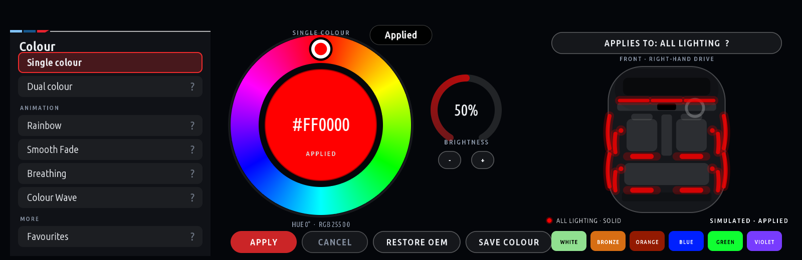
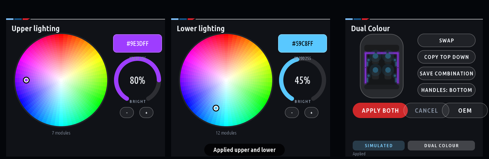
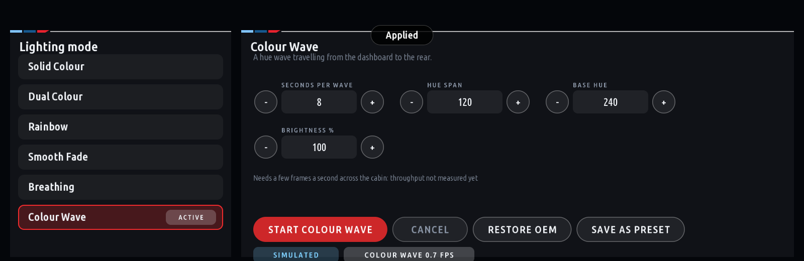
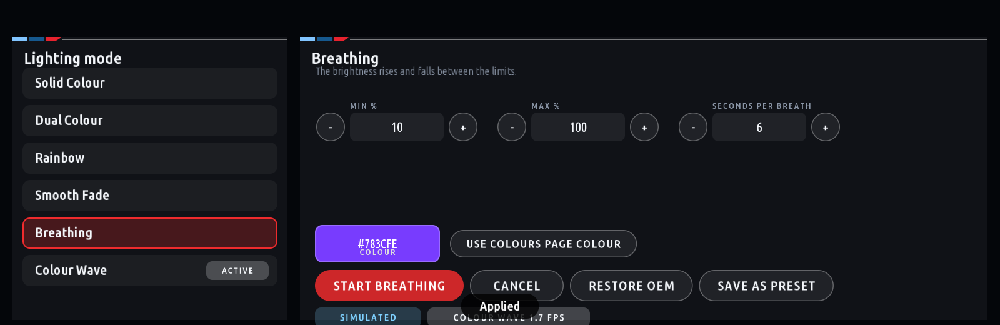
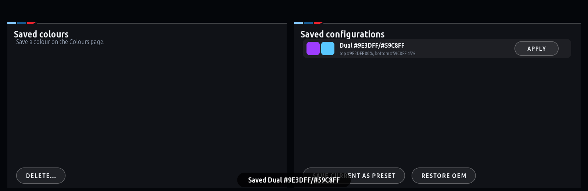
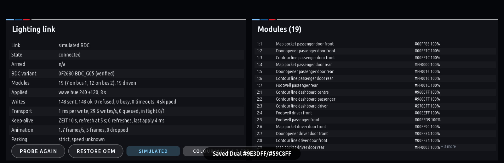

# BMW Ambient RGB Controller

A native iDrive 7 app that gives a BMW G20's factory ambient lighting any colour: a hue ring and
brightness dial on the car's own screen, upper and lower lighting in different colours, zones,
animated modes, and a picture of the cabin showing exactly what the lights will do before you
apply it. It drives the body controller's own per-module RGB actuator, so nothing is coded,
flashed or persisted: every write times out by itself and the factory lighting always comes back.

**Verified on the car** (2020 G20 330e, right-hand drive, iDrive 7 head unit): the per-module writes
were accepted over the diagnostic port, a door contour line stepped through seven colours by eye,
and the modules returned to the factory colour by themselves. The app runs on the laptop in the
head unit's own emulator; installing it on the car is the next step.

The project lives in [bmw-g20-idrive-rgb/](bmw-g20-idrive-rgb/): start with its
[README](bmw-g20-idrive-rgb/README.md), then [INSTALLATION.md](bmw-g20-idrive-rgb/INSTALLATION.md).

## Screens

Rendered by the head unit's own draw engine, as it looks on the car.

| | |
|---|---|
|  |  |
| Colours: pick a hue on the ring, see the cabin lit before Apply | Dual Colour: upper and lower lighting with their own colour and brightness |
|  |  |
| Modes: Solid, Dual, Rainbow, Smooth Fade, Breathing, Colour Wave | Each mode with its own settings; presets saved with one press |
|  |  |
| Favourites: saved colours and complete configurations | Diagnostics: the link, the body controller, all 19 modules, the write statistics |

## What it does

- **Preview, then apply.** Turning the iDrive knob or tapping the ring changes only the screen; the
  car changes on Apply (or the confirming press). Cancel and BACK discard.
- **Colours, Dual, Modes, Favourites, Diagnostics** pages; zones (dashboard, front doors, rear doors,
  footwells, upper, lower) that keep each other's colours; the BDC's own library colours.
- **Rotary first.** Every control works with the knob; touch where the head unit routes it.
- **Safe by design.** Simulated link and disarmed by default; one diagnostic write at a time, paced to
  the car; lighting changes blocked unless the car is known to be parked; Restore OEM releases every
  module and reports exactly what was accepted; optional "apply the last lighting at start".

## Run it on the laptop

```
cd bmw-g20-idrive-rgb
npm test            # 166 Node tests
npm run test:py     # 37 Python tests
npm run emu         # the head unit emulator at http://localhost:8077: mouse = touch, mouse wheel = knob
```

The build and the emulator use the MGU App Kit (MIT), expected at `../research/cauliflowermossgrape_idrive7-apps`
or wherever `IDRIVE7_APPS` points; `clone_research.ps1` fetches it.

## Licence

**Free for personal use.** Commercial use of any kind (charging to install or configure it, selling or
bundling it, advertising or promoting a product or service with it) needs a commercial licence agreed
with the author first; doing so without one is copyright infringement and the user is liable. Anyone
who distributes a modified version must publish their changes under the same terms. Full text:
[LICENSE](bmw-g20-idrive-rgb/LICENSE). The MGU App Kit keeps its own MIT licence; BMW's SDK is never
part of this repository.

Not affiliated with BMW. Your car, your risk: read [ROLLBACK.md](bmw-g20-idrive-rgb/ROLLBACK.md)
before anything touches the car.
