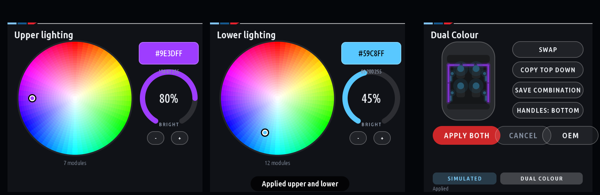
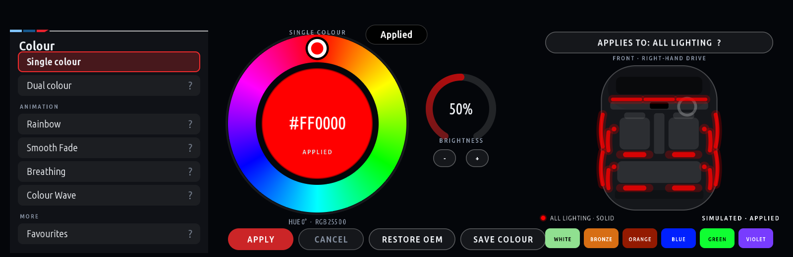

# bmw-g20-idrive-rgb

**BMW Ambient RGB Controller**: a native iDrive 7 (MGU) app with a full colour wheel for the G20's
factory ambient lighting, a `LightingController` abstraction with a complete simulated body
controller, and a read-only ENET discovery tool for the laptop.

Target car: 2020 BMW G20 330e, right-hand drive, MGU head unit, factory ambient lighting, BDC body
controller. **The control path is verified on that car (2026-11-04):** the body controller's documented
actuator accepted per-module RGB writes over ENET in the default session, a door contour line stepped
through seven colours by eye, and the modules return to the OEM colour by themselves (PROTOCOL_FINDINGS.md
§0.1). The app itself has not been installed on the head unit yet; every write path in it is gated and
dry-run by default.





## The one-line finding

The body controller's own diagnostic description (the public SGBD reference for **BDC_G05**, the
BDC-03 generation the G20 belongs to) lists a **per-module RGB actuator**: UDS `2E DA5E` with the
LIN slave address, on/off, brightness, **red, green, blue** and an **activation time of 0..254 s**. The
MGU can send UDS to any control unit through its own diagnostic gateway service (`InternalTasu`), which
the MGU App Kit already uses from inside apps. So "turn the wheel, the lights change, no laptop, no
recoding" has a documented, non-persistent, self-reverting path, **verified on the car** on 2026-11-04:
see [PROTOCOL_FINDINGS.md](PROTOCOL_FINDINGS.md) and [NEXT_STEPS.md](NEXT_STEPS.md).

## What is in here

| Path | What |
|---|---|
| `app/ambient_rgb/` | the iDrive app for the MGU App Kit: `main.js` (five pages: Colours, Dual, Modes, Favourites, Diagnostics), `ui_widgets.js` (colour wheel, circular brightness dial, the rotary editor), `lighting_scene.js` (per-module scene, groups, zones, modes, presets), `lighting_scheduler.js` (the write queue), `lighting_controller.js` (apply / keep-alive / restore), `lighting_mock.js` (simulated BDC, 19 modules, fault injection), `lighting_bdc_uds.js` (the car, over TASU, gated), `lighting_protocol.js` (the bytes, verified), `colour.js`, `favourites.js` |
| `tools/laptop/` | `enetdiag`: the read-only Windows ENET discovery utility (UDS 0x22 only), `write_test.py` (the gated one-frame-per-step write test, with a colour cycle and fades), `catalog_search.py` for the MGU's SOME/IP catalog |
| `tests/` | 88 Node tests (colour, protocol, scene, scheduler with a throughput benchmark, controller, TASU path, favourites, UI) and 24 Python tests (framing, decoding, policy, redaction, a scan against a simulated car) |
| `scripts/` | `stage.js` (lay the app out with the kit runtime for tests), `preview_frames.js` (PNG screenshots), `build_app.py` (the MGU Store release build and its checks), `check_package.js`, `release.ps1` |
| `docs/screens/` | screenshots rendered by the kit's own drawing code |
| `RESEARCH.md` | every repository investigated, with commit SHAs, useful files and verdicts |
| `ARCHITECTURE.md` | MGU, BDC, OEM lighting and the app's control paths |
| `PROTOCOL_FINDINGS.md` | the register of identifiers, payloads, what is verified and what is not |
| `TESTS.md`, `INSTALLATION.md`, `ROLLBACK.md`, `NEXT_STEPS.md` | as named |

## Run it (no car needed)

```
npm test                       # stages the app with the kit runtime and runs the Node tests
npm run test:py                # the Python tests (loopback simulated car included)
npm run preview                # renders the pages to preview/*.png
npm run emu                    # the kit's live emulator: the app drawn by the car's own draw engine at http://localhost:8077
                               # (mouse = touch, mouse wheel or [ ] = the iDrive knob, Enter = press, arrows = tilt, Backspace = BACK)
python scripts/build_app.py    # the MGU Store release: dist/ambient_rgb@<version>.tgz and .mgu, checked (PUBLISHING.md)
cd tools/laptop && python -m enetdiag selftest
```

The kit is expected at `../research/cauliflowermossgrape_idrive7-apps` (or set `IDRIVE7_APPS`).

## What the app does (0.3.0)

- **Preview, then apply.** Turning the knob or tapping the wheel changes only the screen; the car changes on
  Apply, or on the confirming press if you keep that setting on. Cancel and BACK discard.
- **Colours:** the factory-style picker: a list of the ways to light the cabin on the left, the hue ring with the
  chosen colour in its middle, a circular brightness dial and saturation, and the cabin from above on the right
  with every module lit as it would be; a zone picker (all, dashboard, front doors, rear doors, footwells, upper,
  lower), the BDC's library colours, saved colours.
- **Dual Colour:** upper and lower lighting with their own colour and brightness, swap, copy, save, Apply both.
  The door-handle lights belong to whichever group you choose.
- **Modes:** Solid, Dual, Rainbow, Smooth Fade, Breathing, Colour Wave, each with its settings; complete
  configurations saved as presets.
- **Rotary first:** every control is reachable and adjustable with the iDrive knob; touch works where the
  renderer routes it; - / + buttons remain for a unit without the controller gate.
- **Honest restore:** Restore OEM releases every driven module and reports exactly what was accepted.
- **Back every drive (setting, off by default):** *Apply the last lighting at start* brings back the last
  configuration Apply sent when the app starts, once the link is up and the car is known to be parked.
  Restore OEM is the off switch: after it, the car starts with its factory lighting.

## Safety, in short

- The app ships with **Lighting link = Simulated BDC** and **Write to the car = Disarmed**. Armed, it
  sends only `2E DA5E` / `2E E3D1` to the BDC body (0x40) and `10 03` when asked for a session; the
  allow list is enforced in code (`lighting_protocol.js checkRequest`) and covered by tests.
- Lighting changes are blocked unless the car is known to be parked (fail closed when the speed is unknown).
- One diagnostic write at a time; animation frames are paced to the measured transport and never queue up.
- Every write carries a timeout (ZEIT, 10 s by default, 30 s cap): if the app dies, the BDC returns to
  OEM lighting by itself. Restore OEM writes the modules inactive and stops.
- Nothing is coded, flashed or persisted in the car. The laptop tool only reads.
- Not affiliated with BMW. Your car, your risk. Read ROLLBACK.md before anything touches the car.

## Licence

Free for personal use; commercial use (charging to install it, selling or bundling it, advertising with
it) needs a commercial licence agreed with the author first, and anyone distributing a modified version
must publish their changes under the same terms. The full text is in [LICENSE](LICENSE). The MGU App Kit
this builds on keeps its own MIT licence; BMW's SDK is never distributed.
