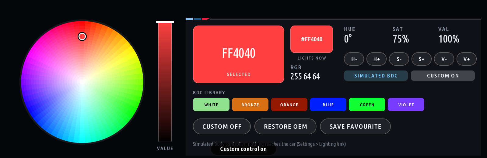

# bmw-g20-idrive-rgb

**BMW Ambient RGB Controller**: a native iDrive 7 (MGU) app with a full colour wheel for the G20's
factory ambient lighting, a `LightingController` abstraction with a complete simulated body
controller, and a read-only ENET discovery tool for the laptop.

Target car: 2020 BMW G20 330e, right-hand drive, MGU head unit, factory ambient lighting, BDC body
controller. Nothing here has been run on that car yet: the app, the protocol and the tests are built
on public documentation and the public MGU App Kit, and every write path is gated and dry-run by default.



## The one-line finding

The body controller's own diagnostic description (the public SGBD reference for **BDC_G05**, the
BDC-03 generation the G20 belongs to) lists a **per-module RGB actuator**: UDS `2E DA5E` with the
LIN slave address, on/off, brightness, **red, green, blue** and an **activation time of 0..254 s**. The
MGU can send UDS to any control unit through its own diagnostic gateway service (`InternalTasu`), which
the MGU App Kit already uses from inside apps. So "turn the wheel, the lights change, no laptop, no
recoding" has a documented, non-persistent, self-reverting path. It is **documented, not yet verified
on a car**: see [PROTOCOL_FINDINGS.md](PROTOCOL_FINDINGS.md) and [NEXT_STEPS.md](NEXT_STEPS.md).

## What is in here

| Path | What |
|---|---|
| `app/ambient_rgb/` | the iDrive app for the MGU App Kit: `app.json` + `main.js` (UI), `colour.js`, `favourites.js`, `lighting_controller.js` (the interface + state machine), `lighting_mock.js` (simulated BDC), `lighting_bdc_uds.js` (the car, over TASU, gated), `lighting_someip.js` (probe only), `lighting_protocol.js` (the bytes) |
| `tools/laptop/` | `enetdiag`: the read-only Windows ENET discovery utility (UDS 0x22 only) + `catalog_search.py` for the MGU's SOME/IP catalog |
| `tests/` | 66 Node tests (colour, protocol, controller, TASU path, favourites, UI) and 21 Python tests (framing, decoding, policy, redaction, a scan against a simulated car) |
| `scripts/` | `stage.js` (lay the app out with the kit runtime for tests), `preview_frames.js` (PNG screenshots), `build_app.py` (the kit's real build) |
| `docs/screens/` | screenshots rendered by the kit's own drawing code |
| `RESEARCH.md` | every repository investigated, with commit SHAs, useful files and verdicts |
| `ARCHITECTURE.md` | MGU, BDC, OEM lighting and the app's control paths |
| `PROTOCOL_FINDINGS.md` | the register of identifiers, payloads, what is verified and what is not |
| `TESTS.md`, `INSTALLATION.md`, `ROLLBACK.md`, `NEXT_STEPS.md` | as named |

## Run it (no car needed)

```
npm test                       # stages the app with the kit runtime and runs the Node tests
npm run test:py                # the Python tests (loopback simulated car included)
npm run preview                # renders the pages to preview/*.png
python scripts/build_app.py    # the kit's build -> dist/ambient_rgb@0.1.0.mgu (needs the real oap-sdk to be installable)
cd tools/laptop && python -m enetdiag selftest
```

The kit is expected at `../research/cauliflowermossgrape_idrive7-apps` (or set `IDRIVE7_APPS`).

## Safety, in short

- The app ships with **Lighting link = Simulated BDC** and **Write to the car = Disarmed**. Armed, it
  sends only `2E DA5E` / `2E E3D1` to the BDC body (0x40) and `10 03` when asked for a session; the
  allow list is enforced in code (`lighting_protocol.js checkRequest`) and covered by tests.
- Every write carries a timeout (ZEIT, 10 s by default, 30 s cap): if the app dies, the BDC returns to
  OEM lighting by itself. Restore OEM writes the modules inactive and stops.
- Nothing is coded, flashed or persisted in the car. The laptop tool only reads.
- Not affiliated with BMW. Your car, your risk. Read ROLLBACK.md before anything touches the car.
